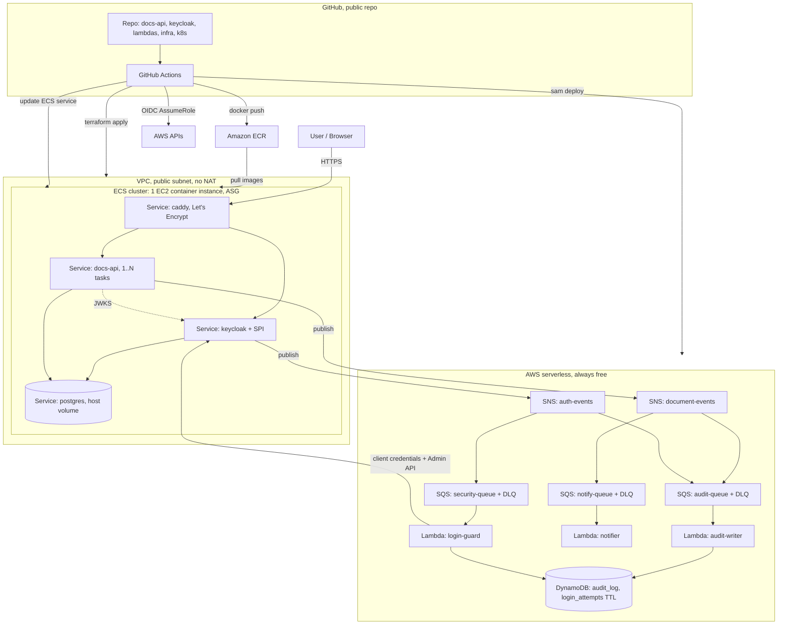
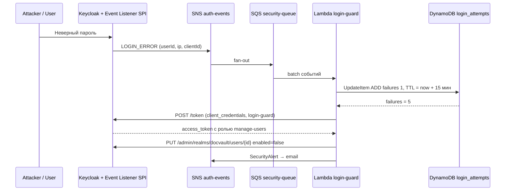
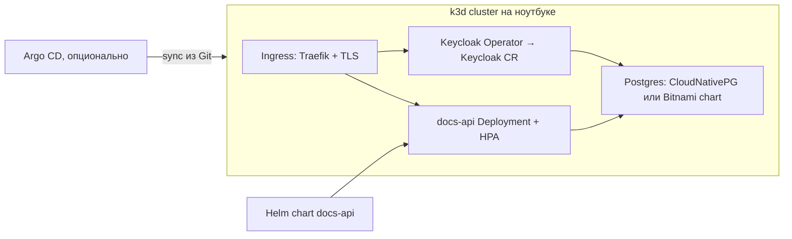

# Pet-проект: Keycloak + Spring Boot + AWS (DocVault)

## Принятые решения

- **Главное условие: $0.** Никаких платных сервисов; AWS — новый аккаунт на **Free plan** (кредиты, 6 месяцев, без списаний с карты). Аккаунт заводится только на этапе 4.
- **В облаке: Amazon ECS на EC2** (не Fargate, не EKS) — оркестрация бесплатна, платим кредитами только за инстанс.
- **Вся AWS-инфраструктура — через Terraform.** Serverless-часть — через AWS SAM (или тоже Terraform).
- **Kubernetes — локально через k3d**: те же образы, Helm, HPA, Keycloak Operator. Бесплатно навсегда.
- **CI/CD — GitHub Actions** в публичном репозитории, доступ в AWS через **access keys отдельного IAM-пользователя в GitHub Secrets** (OIDC недоступен на Free plan: SCP запрещает `iam:*Provider*`; решение владельца). Регион **eu-north-1**. Образы — в **Amazon ECR**.
- Lambda-функции — **Python** (boto3 + Powertools for AWS Lambda), тесты на pytest.
- Event Listener SPI для Keycloak — **Java** (плагины Keycloak пишутся только на Java).

## Идея проекта

**DocVault** — мини-версия документного SaaS: пользователи логинятся через Keycloak, создают документы, делятся ими и отправляют на подпись. Каждое действие и каждый логин пишутся событиями в SNS, дальше их разбирают Lambda-функции через SQS и складывают в DynamoDB.

| Что тренируешь | Где в проекте |
| --- | --- |
| OIDC-логин, роли, mappers, tenant claim | Keycloak + Spring Boot (`docs-api`) |
| Client credentials (сервис-к-сервису) | Lambda `login-guard` получает токен своего service account |
| Keycloak SPI | Event Listener публикует LOGIN / LOGIN_ERROR в SNS |
| **GitHub Actions** | CI на PR, сборка образов, деплой в ECS, Terraform plan/apply, SAM deploy |
| AWS IAM без ключей | GitHub Actions → AWS через OIDC federation |
| **Terraform** | VPC, IAM, ECR, ECS cluster, EC2 Auto Scaling Group, Budget |
| **ECS** | Task definitions, services, rolling deploy, Service Auto Scaling |
| **Kubernetes** | k3d локально: Deployments, Services, Ingress, Helm, HPA, Keycloak Operator |
| Event-driven: SNS fan-out, SQS, DLQ | События документов и логинов |
| Lambda (Python) | Аудит, детектор подозрительных логинов, уведомления |
| DynamoDB | Audit log, идемпотентность, счётчики неудачных логинов с TTL |

## Системный дизайн (AWS)

ECS-кластер из одного EC2-инстанса (4 ГБ RAM) в публичной подсети — без NAT Gateway. На нём ECS-сервисы: Caddy (HTTPS), Keycloak, `docs-api`, Postgres. Serverless-часть — в always-free лимитах. Всё описано в Terraform.



| Компонент | Роль |
| --- | --- |
| Terraform | Описывает VPC, subnets, security groups, IAM (OIDC provider, роли), ECR, ECS cluster, ASG с ECS-optimized AMI, task definitions, services, AWS Budget. State — в S3 (с lockfile) |
| ECS на EC2 | Один container instance (t3.medium, 4 ГБ). Сеть tasks — `bridge` или `host`. Логи — CloudWatch Logs с коротким retention |
| Caddy | HTTPS с Let's Encrypt, домен sslip.io / DuckDNS. Заменяет ALB в обычном режиме |
| Keycloak | Realm `docvault`: clients `web` (public + PKCE), `docs-api` (bearer-only), `login-guard` (service account) |
| docs-api | Spring Boot 3, resource server, публикует события через AWS SDK v2 (права через ECS task role) |
| Postgres | Контейнер с host volume на инстансе вместо RDS |
| ECR | Приватный registry для образов `docs-api` и `keycloak` (с SPI) |
| SNS → SQS → Lambda | Fan-out, retry, DLQ |

**Масштабирование.** Без балансировщика несколько tasks `docs-api` трудно распределить по портам, поэтому эксперименты с Service Auto Scaling делаются так: поднять ALB через Terraform (`enable_alb = true`), включить target tracking по CPU, дать нагрузку (k6 / hey), посмотреть, как ECS добавляет tasks, затем `terraform apply` с `enable_alb = false`. ALB стоит денег, но на пару часов экспериментов это копейки из кредитов.

## Event-driven часть

### 1. Audit log (SNS fan-out → SQS → Lambda → DynamoDB)

`docs-api` публикует `DocumentCreated`, `DocumentShared`, `SignRequested` в топик `document-events`. `audit-writer` читает из своей очереди и пишет в DynamoDB.

- Таблица `audit_log`: PK = `tenantId#documentId`, SK = `timestamp#eventId`. «История документа» = один `Query`.
- GSI по `userId` — «что делал юзер».
- Идемпотентность: `PutItem` с `attribute_not_exists(eventId)` — SQS доставляет at-least-once.

### 2. Уведомления

`notifier` получает только `DocumentShared` и `SignRequested` через **SNS filter policy** и шлёт письмо через email-подписку SNS или просто логирует. Здесь же отрабатывается **DLQ**: намеренно ронять Lambda, смотреть `maxReceiveCount`, делать редрайв из DLQ.

### 3. Login guard (Keycloak SPI → SNS → SQS → Lambda → DynamoDB + Admin API)



Сравнить со встроенным brute force detection Keycloak и подумать, когда внешний детектор оправдан (корреляция по IP между юзерами, новая страна).

## GitHub Actions: что сделать и что выучить

Цель — не просто «зелёный CI», а набор workflows, по которым можно уверенно отвечать на собеседовании.

### Workflows в репозитории

| Файл | Триггер | Что делает |
| --- | --- | --- |
| `ci.yml` | `pull_request` | `mvn verify` (Testcontainers + Keycloak), `pytest` для Lambda, `terraform fmt` + `validate`, линтеры; matrix по модулям |
| `terraform-plan.yml` | `pull_request` с изменениями в `infra/**` | `terraform plan` через OIDC, план — комментарием в PR |
| `build.yml` | `push` в `main` | Сборка образов `docs-api` и `keycloak`, push в ECR с тегом = SHA коммита |
| `deploy-ecs.yml` | после `build.yml` (`workflow_run`) или `workflow_dispatch` | Render task definition с новым образом → deploy ECS service → ожидание стабильности → smoke test |
| `deploy-serverless.yml` | `push` в `main` с изменениями в `lambdas/**` | `sam build` + `sam deploy` |
| `terraform-apply.yml` | `workflow_dispatch` / `push` в `main` с `infra/**` | `terraform apply` в environment `prod` с ручным approval |
| `_reusable-aws-auth.yml` | `workflow_call` | Reusable workflow: OIDC-логин в AWS, переиспользуется остальными |
| `cloud-up.yml` | `workflow_dispatch` | Поднять облако на сессию практики: ASG `desired = 1`, дождаться healthy ECS-сервисов |
| `cloud-down.yml` | `schedule` (каждый день 23:00 UTC) + `workflow_dispatch` | Выключить облако: ASG `desired = 0`, `enable_alb = false`; страховка от забытого инстанса |

### Концепции, которые закрывает проект

- **Структура:** workflow → jobs → steps; `runs-on`; `needs` (зависимости jobs); `if` (условия); `outputs` между jobs.
- **Триггеры:** `push`, `pull_request`, `workflow_dispatch` (ручной запуск с inputs), `workflow_run`, `schedule`; фильтры `branches` и `paths`.
- **Переиспользование:** готовые actions из Marketplace, **composite action** (свой action из нескольких шагов), **reusable workflow** (`workflow_call`).
- **Matrix:** параллельный прогон по модулям / версиям Java.
- **Кэш и артефакты:** `actions/cache` или встроенный кэш `setup-java`; `upload-artifact` для отчётов тестов.
- **Секреты и переменные:** `secrets`, `vars`, **environments** (`dev`, `prod`) с required reviewers и своими секретами.
- **Безопасность:** `permissions` с минимальными правами (`id-token: write` для OIDC, `contents: read`); **OIDC вместо access keys**; pinning actions; Dependabot для обновления actions.
- **Concurrency:** `concurrency` group, чтобы два деплоя не шли одновременно.
- **Runners:** GitHub-hosted vs self-hosted (как идея — можно поднять self-hosted runner в локальном k3d через Actions Runner Controller).

### Скелет `deploy-ecs.yml`

Версии actions проверить на момент написания.

```yaml
name: deploy-ecs
on:
  workflow_dispatch:
  workflow_run:
    workflows: [build]
    types: [completed]
    branches: [main]

permissions:
  id-token: write   # OIDC-токен для AWS
  contents: read

concurrency:
  group: deploy-prod
  cancel-in-progress: false

jobs:
  deploy:
    if: ${{ github.event_name == 'workflow_dispatch' || github.event.workflow_run.conclusion == 'success' }}
    runs-on: ubuntu-latest
    environment: prod            # ручной approval
    steps:
      - uses: actions/checkout@v4

      - uses: aws-actions/configure-aws-credentials@v4
        with:
          role-to-assume: ${{ vars.AWS_DEPLOY_ROLE_ARN }}
          aws-region: eu-west-1

      - id: ecr
        uses: aws-actions/amazon-ecr-login@v2

      - id: taskdef
        uses: aws-actions/amazon-ecs-render-task-definition@v1
        with:
          task-definition: infra/ecs/docs-api-taskdef.json
          container-name: docs-api
          image: ${{ steps.ecr.outputs.registry }}/docs-api:${{ github.sha }}

      - uses: aws-actions/amazon-ecs-deploy-task-definition@v2
        with:
          task-definition: ${{ steps.taskdef.outputs.task-definition }}
          cluster: docvault
          service: docs-api
          wait-for-service-stability: true

      - name: Smoke test
        run: ./scripts/smoke-test.sh   # получить токен в Keycloak, вызвать docs-api
```

## Terraform

Структура `infra/`:

```
infra/
  bootstrap/        # S3 bucket для state, GitHub OIDC provider, роли для CI (применяется один раз вручную)
  modules/
    network/        # VPC, public subnets, security groups
    ecs-cluster/    # ECS cluster, ASG + launch template (ECS-optimized AMI), capacity provider
    ecs-service/    # task definition + service (переиспользуется для caddy, keycloak, docs-api, postgres)
    alb/            # опционально, включается флагом для экспериментов с масштабированием
  envs/
    prod/           # main.tf, variables.tf, terraform.tfvars
```

Что потренировать: модули и переменные, `outputs`, remote state в S3, `terraform plan` в PR, `import` существующего ресурса, `for_each`, флаг-переменные (`enable_alb`), `terraform destroy` в конце дня, чтобы не тратить кредиты.

## Kubernetes локально (k3d)

Те же образы, что едут в ECS, — и сравнение двух оркестраторов на одном проекте.



- [ ] Поднять k3d-кластер с локальным registry.
- [ ] Helm-чарт для `docs-api`: Deployment, Service, Ingress, ConfigMap, Secret, liveness/readiness probes, resources.
- [ ] Keycloak через официальный Keycloak Operator (CRD `Keycloak`, `KeycloakRealmImport`).
- [ ] Postgres через CloudNativePG или Bitnami-чарт.
- [ ] HPA для `docs-api` по CPU + нагрузочный тест; сравнить с ECS Service Auto Scaling.
- [ ] Опционально: Argo CD (GitOps) и GitHub Actions job, которая обновляет тег образа в Helm values.
- [ ] Записать таблицу «ECS vs Kubernetes» по своим впечатлениям — готовый материал для собеседований.

## Как гарантировать $0

**Новый AWS-аккаунт на Free plan.** Аккаунты, созданные после 15 июля 2025, выбирают Free или Paid. На Free plan — $100 кредитов сразу и до $100 за выполнение заданий; с карты ничего не списывается: через 6 месяцев или когда кончатся кредиты AWS закрывает аккаунт (данные хранятся 90 дней).

- [ ] При регистрации выбрать **Free plan**, а не Paid.
- [ ] Не подключать аккаунт к AWS Organizations — это переводит на Paid без возврата.
- [ ] Не нажимать «Upgrade», когда придут письма об окончании.
- [ ] AWS Budget с алертом (тоже через Terraform), чтобы видеть расход кредитов.

| Ресурс | Статус |
| --- | --- |
| Lambda, SQS, SNS, DynamoDB | Always-free (ориентировочно: Lambda 1 млн запросов/мес, SQS и SNS по 1 млн/мес, DynamoDB 25 ГБ — сверить на aws.amazon.com/free) |
| ECS (control plane) | Бесплатно при запуске на EC2 |
| EC2 t3.medium (4 ГБ) + EBS + публичный IPv4 | Из кредитов, ориентировочно ~$30–35/мес при работе 24/7. Выключать (ASG desired = 0), когда не работаешь |
| ECR, CloudWatch Logs, S3 для state | Копейки; lifecycle policy в ECR (хранить последние ~10 образов), retention логов 3–7 дней |
| ALB | Только на время экспериментов с масштабированием, потом выключать флагом |
| GitHub Actions | Бесплатно для публичного репо |
| Kubernetes (k3d) | Локально, $0 |
| Домен + TLS | sslip.io / DuckDNS + Let's Encrypt — $0 |

Чего избегать: NAT Gateway (Lambda не класть в VPC, ECS — в публичной подсети), Fargate и EKS для постоянной работы, RDS, забытые Elastic IP и снапшоты, бесконечный retry Lambda без DLQ, секреты в публичном репо (только GitHub Secrets / SSM Parameter Store).

Через 6 месяцев аккаунт закроется — всё описано кодом (Terraform + SAM + Helm) и поднимается заново.

### Бюджет кредитов: схема «облако только на время практики»

На Free plan со своей карты не списывается ничего: когда кредиты кончатся или пройдут 6 месяцев, аккаунт просто закроется. Задача — чтобы кредитов хватило на все 6 месяцев.

1. **Максимум работы локально.** Keycloak, Spring, CI, Kubernetes (k3d) — на ноутбуке. В AWS — только ECS, Terraform, деплой и serverless.
2. **EC2 работает только во время практики.** Остальное время ASG `desired = 0`. Ориентировочно t3.medium ≈ $0.05/час; при ~80 часах в месяц это ~$4–5, вместе с EBS, IPv4 и логами ~$6–10/мес — кредитов хватает на 6 месяцев с запасом.
3. **Автовыключение.** `cloud-down.yml` по расписанию каждый вечер ставит ASG в 0 и выключает ALB — забытый инстанс не горит ночью.
4. **Дорогое — только флагом и ненадолго.** ALB — на час-два экспериментов с масштабированием.
5. **Ничего не хранить в облаке «на потом».** Realm импортируется из JSON, данные Postgres тестовые; `terraform destroy` и подъём заново — ~10 минут.
6. **Serverless практически бесплатен.** Lambda, SNS, SQS, DynamoDB при учебной нагрузке укладываются в always-free.

Защита от ошибок: Free plan при регистрации; не подключать AWS Organizations; не создавать NAT Gateway, EKS, Fargate; AWS сам уведомляет при 50%, 25% и 10% оставшихся кредитов.

## План по этапам

Этапы 1–3 и 8 — полностью локальные. AWS-аккаунт заводится только к этапу 4.

**Этап 1 — Локальный Keycloak + Spring (Docker Compose)**

- [x] Monorepo `docvault`: `docs-api/`, `keycloak/`, `lambdas/`, `infra/`, `k8s/`, `.github/workflows/`, `docker-compose.yml`.
- [x] Compose: Keycloak + Postgres + `docs-api`; realm `docvault` импортируется из JSON при старте.
- [x] `docs-api` как resource server: CRUD документов, роли `viewer`/`editor`/`admin`, claim `tenant_id` через mapper.
- [x] Fine-grained права: шаринг документа конкретному юзеру, проверка в `@PreAuthorize`.
- [x] Тесты: `spring-security-test` + Testcontainers с реальным Keycloak.

**Этап 2 — Фронт и флоу**

- [x] Логин через браузер: простая SPA (Authorization Code + PKCE) или BFF на Spring (`oauth2Login`). Сделано: SPA на чистом JS (`web/`, nginx в compose). BFF можно сделать позже для сравнения.
- [x] Refresh и logout (в SPA; PKCE S256 обязателен в клиенте `web`; CORS в `docs-api`).
- [x] MFA (OTP): проверено локально на пользователе `dave` (Required action «Configure OTP»); в `realm-docvault.json` не добавлялось, потому что у пользователя с OTP не работает password grant, на котором держатся тесты. Passkey пропущен по решению владельца (в Keycloak 26.8 нужна сборка отдельного потока входа).
- [ ] Брокеринг: «Войти через GitHub» (бесплатный OAuth App). Отложено по решению владельца, можно вернуться после CI.

**Этап 3 — CI в GitHub Actions**

- [x] `ci.yml`: matrix по Java 21 и 25, кэш Maven, отчёты тестов как артефакты. Сделано для `docs-api`.
- [ ] `pytest` и `terraform fmt/validate` в `ci.yml`: добавить, когда появятся `lambdas/` и `infra/` (сейчас проверять нечего).
- [x] Composite action для общей подготовки (Java + кэш): `.github/actions/setup-java-maven`.
- [x] Branch protection: ruleset `protect-main` (merge только через PR при зелёных `build (21)` и `build (25)`, force push и удаление `main` запрещены); Dependabot для maven, github-actions и docker (`.github/dependabot.yml`).

**Этап 4 — AWS-фундамент через Terraform**

- [ ] AWS-аккаунт на Free plan, MFA на root, свой IAM-пользователь / Identity Center, Budget alert.
- [ ] `infra/bootstrap`: S3 для state, бюджет, IAM-пользователь `ci-deploy` с access key для GitHub Secrets (вместо OIDC provider и ролей: OIDC недоступен на аккаунте).
- [ ] Модули `network`, `ecs-cluster`, ECR-репозитории.
- [ ] `terraform-plan.yml` (план в PR) и `terraform-apply.yml` (environment `prod` с approval).

**Этап 5 — CD в ECS**

- [ ] `build.yml`: образы `docs-api` и `keycloak` (с SPI) → ECR, тег = SHA.
- [ ] Модуль `ecs-service`: caddy, keycloak, postgres, docs-api.
- [ ] `deploy-ecs.yml`: render task definition → deploy → wait for stability → smoke test.
- [ ] Rolling deploy и откат на предыдущую task definition.
- [ ] `cloud-up.yml` и `cloud-down.yml` (автовыключение по расписанию) — до того, как облако начнёт работать постоянно.
- [ ] Эксперимент с масштабированием: `enable_alb = true`, target tracking, нагрузка, выключить ALB.

**Этап 6 — Serverless**

- [ ] SAM (или Terraform): топики `document-events` и `auth-events`, три очереди с DLQ, таблицы `audit_log` и `login_attempts` (TTL).
- [ ] `docs-api` публикует события (сначала напрямую, потом через transactional outbox).
- [ ] Lambda `audit-writer` с идемпотентной записью; Lambda `notifier` с filter policy и тестом DLQ.
- [ ] `deploy-serverless.yml`.

**Этап 7 — Keycloak SPI + login guard**

- [ ] Event Listener SPI на Java, собирается в образ Keycloak, публикует в `auth-events`.
- [ ] Lambda `login-guard` (Python): счётчик в DynamoDB, client credentials, блокировка через Admin API, email-алерт.
- [ ] Сравнить со встроенным brute force detection Keycloak.

**Этап 8 — Kubernetes локально (k3d)**

- [ ] Всё из раздела «Kubernetes локально».

**Этап 9 — По желанию**

- [ ] API Gateway HTTP API + JWT authorizer на Keycloak для Lambda-эндпоинта `GET /audit/{docId}`.
- [ ] Учебный CodePipeline V2 для одной Lambda — для сравнения с GitHub Actions.
- [ ] Self-hosted GitHub runner в k3d через Actions Runner Controller.
- [ ] README с диаграммами и таблицей «ECS vs Kubernetes» — готовый кейс для портфолио.
